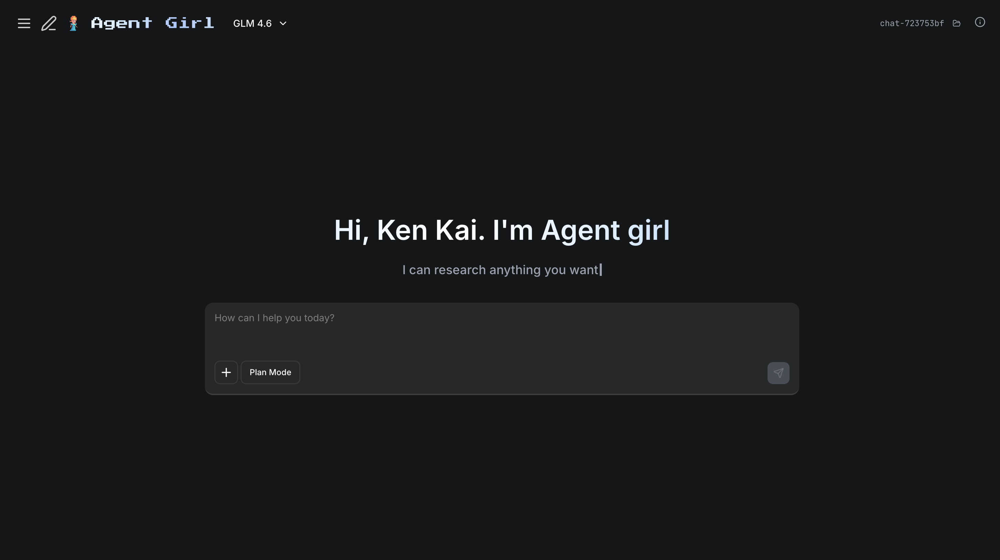

<div align="center">

# Agent Girl

**A modern chat interface powered by the Claude Agent SDK**

[](https://www.gnu.org/licenses/agpl-3.0)
[](https://www.typescriptlang.org/)
[](https://reactjs.org/)
[](https://bun.sh/)
[](https://www.anthropic.com/claude)




Seamless AI conversations with real-time streaming, session management, and specialized sub-agents. Built with React, TypeScript, and Bun for blazing-fast performance.

[Getting Started](#-quick-start) • [Features](#-features) • [Installation](#-installation) • [Contributing](#-contributing)

</div>

> [!TIP]
> **Want to build your own apps with AI?** A free 7-day build challenge and 20+ step-by-step projects are in my free community: **[skool.com/raid](https://www.skool.com/raid)**

---

## 📋 Table of Contents

- [🌟 Overview](#-overview)
- [✨ Features](#-features)
- [🚀 Installation](#-installation)
- [📖 Quick Start](#-quick-start)
- [🎮 Usage](#-usage)
- [🛠️ Development](#️-development)
- [📚 Architecture](#-architecture)
- [🔧 Configuration](#-configuration)
- [🐛 Troubleshooting](#-troubleshooting)
- [🤝 Contributing](#-contributing)
- [📄 License](#-license)

---

## 🌟 Overview

Agent Girl is a **desktop-first chat interface** that brings the power of Anthropic's Claude Agent SDK to your local machine. Unlike web-based alternatives, Agent Girl runs entirely on your computer with full file system access, persistent sessions, and no data leaving your machine except API calls to Claude.

**Perfect for:**
- 🔧 Developers needing AI assistance with code
- 📁 Power users who want file system access
- 🔒 Privacy-conscious individuals (all data stored locally)
- ⚡ Anyone seeking blazing-fast AI interactions

---

## ✨ Features

### 🤖 Powered by Claude Agent SDK
- **Claude Sonnet 4.5** - Anthropic's most intelligent model
- **Specialized Sub-Agents** - Researcher, code reviewer, debugger, test writer, documenter
- **Full Tool Access** - Read, write, edit files, search code, run commands
- **MCP Integration** - Model Context Protocol for extensibility

### 💬 Real-Time Streaming
- **WebSocket-Based** - Instant responses as Claude types
- **Live Updates** - See tool use in real-time
- **Nested Visualization** - Sub-agent tools displayed under parent tasks

### 🗂️ Session Management
- **SQLite Persistence** - All conversations saved locally
- **Session Isolation** - Each chat has its own working directory
- **Auto-Titles** - Sessions named from first message
- **Full History** - Never lose a conversation

### 🎨 Modern UI/UX
- **Clean Interface** - Built with Radix UI components
- **Dark Mode** - Easy on the eyes
- **Virtual Scrolling** - Smooth performance with long conversations
- **Syntax Highlighting** - Beautiful code blocks
- **Smooth Animations** - Powered by Framer Motion

### 🌐 Multi-Provider Support
- **Anthropic** - Direct Claude API access
- **Z.AI** - Alternative provider with GLM models + web search
- **Easy Switching** - Change providers via dropdown

### ⚡ Developer Experience
- **Hot Reload** - Instant updates during development
- **TypeScript** - Full type safety
- **Bun Runtime** - Ultra-fast builds and execution
- **Zero Config** - SQLite just works

---

## 🚀 Installation

### Universal One-Line Install

**Works on macOS, Linux, and Windows (Git Bash/WSL):**

```bash
curl -fsSL https://raw.githubusercontent.com/KenKaiii/agent-girl/master/install.sh | bash
```

**What it does:**
- ✅ Auto-detects your OS and architecture
- ✅ Downloads the correct release for your platform
- ✅ Installs to platform-specific location
- ✅ Creates global command (macOS/Linux)
- ✅ Sets up API key configuration
- ✅ macOS: Apple-signed & notarized (no warnings)

**Supported Platforms:**
- macOS (Intel + Apple Silicon)
- Linux (x64 + ARM64)
- Windows x64 (via Git Bash/WSL)

### Windows PowerShell (Alternative)

**For native Windows PowerShell:**

```powershell
iwr -useb https://raw.githubusercontent.com/KenKaiii/agent-girl/master/install.ps1 | iex
```

Provides better Windows integration with automatic PATH setup.

### Manual Download

**macOS:**
- [Apple Silicon (M1/M2/M3/M4)](https://github.com/KenKaiii/agent-girl/releases/latest/download/agent-girl-macos-arm64.zip)
- [Intel (x86_64)](https://github.com/KenKaiii/agent-girl/releases/latest/download/agent-girl-macos-intel.zip)

**Windows:**
- [Windows x64](https://github.com/KenKaiii/agent-girl/releases/latest/download/agent-girl-windows-x64.zip)

**Browse all releases:** [https://github.com/KenKaiii/agent-girl/releases](https://github.com/KenKaiii/agent-girl/releases)

---

## 📖 Quick Start

### 1. Configure API Key

Before first run, add your Anthropic API key:

```bash
# macOS/Linux
nano ~/Applications/agent-girl-app/.env

# Windows
notepad %USERPROFILE%\Documents\agent-girl-app\.env
```

Replace `sk-ant-your-key-here` with your actual key from [console.anthropic.com](https://console.anthropic.com/).

### 2. Launch the App

**macOS:**
```bash
agent-girl
```

**Windows:**
- Double-click `agent-girl.exe` in the install directory

**From Finder/Explorer:**
1. Navigate to install directory
2. Double-click the `agent-girl` executable

The app starts at **http://localhost:3001** and opens automatically in your browser.

### 3. Start Chatting

1. Click **"New Chat"** to create a session
2. Select a working directory (or use default)
3. Choose your model (Claude Sonnet 4.5 recommended)
4. Start your conversation!

---

## 🎮 Usage

### Session Management

**Create a Session:**
- Click **"New Chat"** in sidebar
- Choose working directory for file operations
- Sessions are isolated - files stay organized

**Rename Session:**
- Click pencil icon → Enter new name → Press Enter

**Delete Session:**
- Click trash icon → Confirm deletion (permanent)

### Model Selection

**Anthropic Models:**
- **Claude Sonnet 4.5** ⭐ - Best for complex tasks
- Direct API access to latest Claude models

**Z.AI Models:**
- **GLM-4.7** - Alternative with web search MCP
- Great for research tasks

Switch anytime via header dropdown.

### Custom Sub-Agents

Claude can spawn specialized agents using the Task tool:

| Agent | Purpose |
|-------|---------|
| **researcher** | Information gathering and analysis |
| **code-reviewer** | Bug detection, security, best practices |
| **debugger** | Systematic bug hunting |
| **test-writer** | Comprehensive test suite creation |
| **documenter** | Clear docs and examples |

Sub-agent activity displays nested under parent tasks for clarity.

### Working Directories

Each session has an isolated working directory:

- **Default:** `~/Documents/agent-girl-app/{session-id}/`
- **Custom:** Choose any directory when creating
- **Safety:** File operations scoped to this directory only

---

## 🛠️ Development

### Prerequisites

- [Bun](https://bun.sh/) v1.0.0+
- macOS, Linux, or WSL (Windows Subsystem for Linux)
- Node.js 18+ (optional, for compatibility testing)

### Local Development

```bash
# Clone repository
git clone https://github.com/KenKaiii/agent-girl.git
cd agent-girl

# Install dependencies
bun install

# Create environment file
cat > .env << EOF
API_PROVIDER=anthropic
ANTHROPIC_API_KEY=sk-ant-your-key-here
EOF

# Start development server
bun run dev
```

Development server runs at **http://localhost:3001** with hot reload.

### Build from Source

Build for your current platform:

```bash
# Single platform build
./build-release.sh

# All platforms (macOS ARM64, Intel, Windows, Linux)
./build-release-all.sh
```

Binaries output to `./release/`.

### Run Tests

```bash
# Run all tests
bun test

# Watch mode
bun test --watch
```

---

## 📚 Architecture

### Tech Stack

**Frontend:**
- React 18 + TypeScript
- Radix UI (accessible components)
- Tailwind CSS 4 (utility-first styling)
- Framer Motion (animations)
- React Virtual (performance)
- React Markdown (message rendering)

**Backend:**
- Bun runtime (high performance)
- Claude Agent SDK (AI interactions)
- SQLite (session persistence)
- WebSocket (real-time streaming)
- MCP (Model Context Protocol)

### Project Structure

```
agent-girl/
├── client/                 # React frontend
│   ├── components/
│   │   ├── chat/          # ChatContainer, MessageList, ChatInput
│   │   ├── message/       # Message renderers
│   │   ├── sidebar/       # Session sidebar
│   │   └── header/        # Header, model selector, about modal
│   ├── hooks/             # useWebSocket, useSessionAPI
│   ├── config/            # Model/provider configuration
│   └── index.tsx          # App entry point
├── server/
│   ├── server.ts          # Main server, WebSocket, SDK integration
│   ├── database.ts        # Session & message persistence
│   ├── providers.ts       # Multi-provider config
│   ├── agents.ts          # Custom agent registry
│   ├── mcpServers.ts      # MCP server config
│   └── systemPrompt.ts    # Dynamic system prompts
├── .github/workflows/     # CI/CD for releases
├── build-release.sh       # Build script (single platform)
├── build-release-all.sh   # Build script (all platforms)
└── install.sh             # One-line installer
```

---

## 🔧 Configuration

### Environment Variables

Create `.env` in app directory:

```env
# Anthropic (Claude models)
ANTHROPIC_API_KEY=sk-ant-your-key-here

# Z.AI (GLM models, optional)
ZAI_API_KEY=your-zai-key-here
```

### Advanced Configuration

**Custom Agents:**

Edit `server/agents.ts`:

```typescript
export const AGENT_REGISTRY: Record<string, AgentDefinition> = {
  'my-agent': {
    description: 'Brief description for agent list',
    prompt: 'Detailed instructions...',
    tools: ['Read', 'Write', 'Grep'], // Optional tool restrictions
    model: 'sonnet', // Optional model override
  },
};
```

**MCP Servers:**

Configure per-provider in `server/mcpServers.ts`:

```typescript
export const MCP_SERVERS_BY_PROVIDER: Record<ProviderType, Record<string, McpServerConfig>> = {
  'my-provider': {
    'my-mcp-server': {
      type: 'http',
      url: 'https://api.example.com/mcp',
      headers: { 'Authorization': `Bearer ${process.env.API_KEY}` },
    },
  },
};
```

**System Prompt:**

Customize Claude's behavior in `server/systemPrompt.ts`.

---

## 🐛 Troubleshooting

### Port Already in Use

```bash
# macOS/Linux
lsof -ti:3001 | xargs kill -9

# Windows
netstat -ano | findstr :3001
taskkill /PID <PID> /F
```

### API Key Issues

1. Verify `.env` exists in app directory
2. Check key format: `sk-ant-...` for Anthropic
3. Restart app after changing `.env`

### Database Reset

```bash
# macOS/Linux
rm -rf ~/Documents/agent-girl-app/

# Development
rm -rf data/ && mkdir data
```

### macOS Security Warnings

**First run:**
1. Right-click `agent-girl` → **"Open"**
2. Click **"Open"** in security dialog

Or via System Preferences:
1. **System Preferences** → **Security & Privacy**
2. Click **"Open Anyway"**

**Note:** Official releases are Apple-notarized and shouldn't show warnings.

---

## 🤝 Contributing

Contributions welcome! Here's how:

1. **Fork** the repository
2. **Create** a feature branch: `git checkout -b feature/amazing-feature`
3. **Make** your changes
4. **Test** thoroughly: `bun test`
5. **Commit**: `git commit -m 'Add amazing feature'`
6. **Push**: `git push origin feature/amazing-feature`
7. **Open** a Pull Request

### Guidelines

- **TypeScript** - Use strict typing
- **Code Style** - Follow existing patterns
- **Testing** - Add tests for new features
- **Documentation** - Update README and comments

---

## 📄 License

This project is licensed under the **GNU Affero General Public License v3.0 (AGPL-3.0)**.

**What this means:**
- ✅ **Free to use** - Personal or commercial
- ✅ **Modify freely** - Adapt to your needs
- ✅ **Distribute** - Share with others
- ⚠️ **Share modifications** - If you run as a service, you must share your source code
- ⚠️ **Keep license** - Derivatives must also be AGPL-3.0

See the [LICENSE](LICENSE) file for full terms.

**TL;DR:** You can use, modify, and distribute Agent Girl freely, but if you modify it and run it as a public service, you must share your source code under the same license.

---

## 🙏 Credits

**Created by [KenKai](https://github.com/KenKaiii)**

**Built with:**
- [Anthropic Claude Agent SDK](https://github.com/anthropics/anthropic-sdk-typescript) - AI capabilities
- [Bun](https://bun.sh/) - Lightning-fast runtime
- [React](https://reactjs.org/) - UI framework
- [Radix UI](https://www.radix-ui.com/) - Accessible components
- [Tailwind CSS](https://tailwindcss.com/) - Utility-first styling
- [Framer Motion](https://www.framer.com/motion/) - Smooth animations

**Special thanks to:**
- Anthropic team for the Claude Agent SDK
- Open source community for amazing tools

---

## 📞 Support

- **GitHub Issues**: [Report bugs](https://github.com/KenKaiii/agent-girl/issues)
- **GitHub Discussions**: [Ask questions](https://github.com/KenKaiii/agent-girl/discussions)
- **YouTube**: [@kenkaidoesai](https://www.youtube.com/@kenkaidoesai)
- **Free Skool community**: [skool.com/raid](https://www.skool.com/raid)

---

<div align="center">

**Built with ❤️ using Claude Agent SDK**

Copyright © 2025 KenKai • Licensed under AGPL-3.0

[⬆ Back to Top](#agent-girl)

</div>
